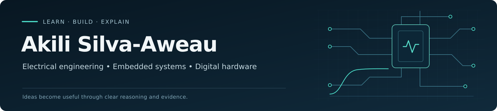

# Akili Silva-Aweau

I’m a U.S. Navy Seabee and an Oxnard College student working toward a bachelor’s degree in electrical engineering.

My focus is embedded systems, firmware, and digital hardware, followed by controls and instrumentation. I’m building my foundation in mathematics, C++, circuits, and practical engineering documentation.

## How I work

**Predict → solve → simulate → measure → explain.**

I want each project to show the question, the engineering decisions, the evidence, and what I learned. Analytical examples, simulations, and hardware measurements are labeled separately.

## Engineering work

- [Electrical engineering labs](https://github.com/akilisilvaaweau31/electrical-engineering-labs): my developing home for programming, circuit, digital logic, and embedded systems work.

## Interests I’m developing

- Microcontrollers, firmware, and digital interfaces
- Test instrumentation and circuit debugging
- Control systems, signal processing, and robotics
- Useful applications of AI in engineering

This profile reflects my current learning direction. Individual project READMEs describe what has actually been implemented and verified.
